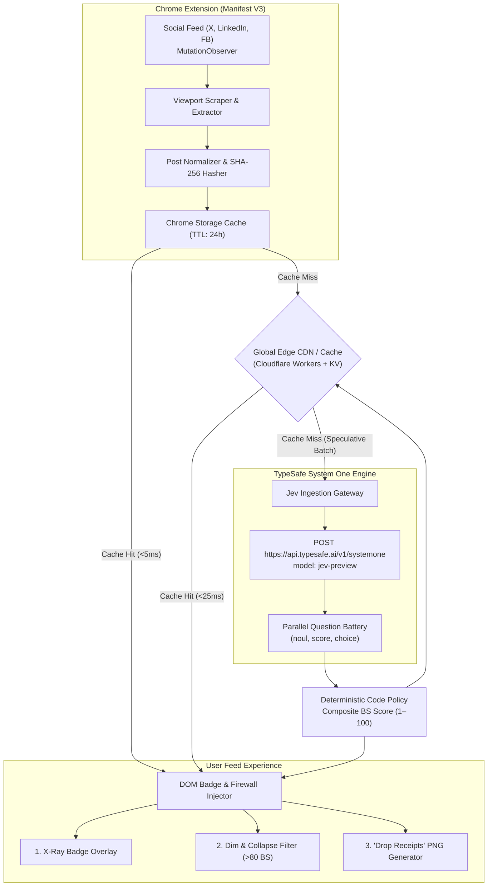

# 🛡️ Jevchrome (SlopShield)

> **Real-time BS & Rage-Bait Firewall Chrome Extension for X, Facebook, and LinkedIn powered by Jev (TypeSafe System One) typed judgments.**

[](https://developer.chrome.com/docs/extensions/mv3/intro/)
[](https://typesafe.ai)
[](LICENSE)
[]()

---

## 📌 Executive Overview

Social media feeds are no longer optimized for substance, discovery, or truth—they are ruthlessly tuned for **dwell time and emotional hijacking**. The current algorithmic landscape rewards three predominant classes of toxic content:

1. **Rage-Bait & Outrage Farming**: Deliberately flawed takes, bad-faith strawmen, and inflammatory claims constructed specifically to bait users into angry quote-tweets and replies.
2. **AI Hustle & DM-Gate Slop**: Fabricated passive-income claims (*"I made $7,625 overnight with Claude, comment 'SetUp' to get the blueprint"*) designed to harvest followers and algorithmic engagement.
3. **LinkedIn & Facebook Fabrications**: Fictitious tear-jerker leadership stories, staged photos, and fake screenshots engineered for engagement virality.

### Why Traditional "AI Fact Checkers" Failed

Prior attempts at automated feed moderation relied on conventional generative Large Language Models (LLMs) prompting essays in prose. This approach is fatally flawed:
- **Too Slow**: Generative streaming takes 3–6 seconds per post, rendering it useless for infinite-scroll feeds.
- **Prohibitively Expensive**: Standard LLM prompts cost \$0.02–\$0.05 per evaluation, blowing up operational costs.
- **User Experience Friction**: Users do not want preachy, patronizing paragraphs of LLM prose cluttering their timeline.

### The Jev Paradigm: Fast, Typed Semantic Judgments

**Jevchrome** replaces generative prose with **TypeSafe's System One model (`Jev`)**. Jev behaves as a high-speed, deterministic semantic sensor. Rather than asking an LLM to generate unstructured opinions, Jev evaluates targeted, structured micro-questions returning calibrated mathematical primitives (`noul` probabilities from 0.00 to 1.00, categorical `choice`, and graded `score`). 

Code owns the feed policy, scoring algorithms, and DOM manipulation; Jev supplies the calibrated semantic discernment.

---

## 🏗️ System Architecture



### Core Architecture Components

1. **Feed Observer & Viewport Scraper**:
   - Manifest V3 content script attaches high-performance `MutationObserver` listeners tailored to each platform's DOM selectors (`article[data-testid="tweet"]`, `.feed-shared-update-v2`, `div[role="feed"] > div`).
   - Extracts post text, author metadata, timestamp, engagement metrics, and embedded links.

2. **Global Edge Cache & Deduplication**:
   - Posts are canonicalized and hashed: `post_hash = SHA256(normalized_text + author_handle)`.
   - Keys are versioned: `cache_key = ${post_hash}:${question_version}:${model_id}`.
   - **The Power-Law Advantage**: Because viral engagement bait follows extreme power-law distributions (1% of viral posts generate 90%+ of total impressions), over **95% of live impressions hit the edge cache in <25ms at \$0 incremental LLM cost**.

3. **Deterministic Evaluation Pipeline**:
   - Uncached posts are batched into requests sent to Jev using `"model": "jev-preview"`.
   - The returned probabilities are piped into deterministic weighting logic to generate a transparent **1–100 Bullshit Score**.

---

## ⚡ The Jev Question Battery

All evaluations are structured as narrow, falsifiable, typed questions passed to `POST https://api.typesafe.ai/v1/systemone` using `"model": "jev-preview"`.

### Request Payload Specification

```json
{
  "model": "jev-preview",
  "state": {
    "post": {
      "author": "@techluisenzo (Luis Enzo)",
      "author_bio": "AI Tools & Automation || Tech Reviews & Tutorials || Future Technology Insight || Digital Innovations",
      "text": "I generated $7625 overnight using an automated Claude setup.\n\nI’ve documented the exact, step-by-step process behind this timezone arbitrage strategy.\n\nWhat you need👇\n• Claude\n• A Mobile\n• 24 hours to test it ( no cost )\n\nHow to access the guide👇\n1. Comment “ SetUp ”\n2. Like & RT\n3. Follow @techluisenzo  (so I can send it via DM)\n\nThe system runs continuously, scanning global news across Japanese, European, Australian, and Middle Eastern markets.\n\nIt identifies pricing inefficiencies situations where outcomes are already reflected overseas, but U.S. markets have yet to adjust.\n\nAfter 9 days of running this setup, the results have been consistent and eye opening.\n\nMost traders focus on EST. Markets don’t.\n\nWhile one region sleeps, another resolves events in real time.\n\nThat timing gap is the opportunity.\n\nFollow @techluisenzo  to receive the full breakdown.\n\n( First 1500 people will get it! Like, comment, and follow quickly )",
      "metrics": {
        "views": 28554,
        "likes": 427,
        "retweets": 181,
        "replies": 336,
        "bookmarks": 227
      }
    }
  },
  "questions": {
    "bullshit_tier": {
      "type": "score",
      "instructions": "How much of `post.text` is fabricated hype, engagement-farming bait, or financially implausible bullshit rather than a genuine, verifiable technical breakdown?",
      "criteria": [
        "Grounded and credible: specific, verifiable technical details, realistic caveats, and no engagement gatekeeping.",
        "Mildly exaggerated: real technical substance mixed with promotional framing or optimistic benchmarks.",
        "Heavy marketing fluff: vague buzzwords and cherry-picked claims with minimal concrete mechanism.",
        "Classic engagement-bait hustle: implausible passive-income claims, hand-wavy 'AI arbitrage' buzzwords, and comment/RT/follow gatekeeping with zero verifiable proof.",
        "Pure fabricated scam or total bullshit: completely impossible financial or technical claims designed solely to farm engagement or lure victims."
      ]
    },
    "engagement_farming_gate": {
      "type": "noul",
      "instructions": "Does `post.text` withhold the actual substance behind a 'Comment keyword + Like/RT + Follow for DM' engagement-farming funnel with artificial scarcity?"
    },
    "implausible_financial_claim": {
      "type": "noul",
      "instructions": "Does `post.text` claim an implausible effortless windfall (such as thousands of dollars overnight using only a consumer chatbot and a phone at zero cost)?"
    },
    "economically_incoherent_mechanism": {
      "type": "noul",
      "instructions": "Is the claimed trading mechanism in `post.text` (using a consumer LLM and a mobile phone to beat institutional high-frequency traders on cross-timezone global news arbitrage) economically and technically incoherent?"
    },
    "zero_verifiable_evidence": {
      "type": "noul",
      "instructions": "Does `post.text` fail to provide any verifiable evidence, code, trade logs, or reproducible technical details in the post itself?"
    },
    "primary_intent": {
      "type": "choice",
      "instructions": "What is the primary nature of `post.text`?",
      "criteria": {
        "genuine_engineering": "Sharing a real, reproducible technical workflow or trading system",
        "product_marketing": "Promoting a legitimate commercial SaaS or developer tool",
        "engagement_bait_slop": "Engagement-farming AI hustle-bro bait using fabricated profit claims to farm followers, replies, and retweets",
        "satire": "Intentional parody or satire of AI hustle posts",
        "other": "None of the above"
      }
    }
  }
}
```

### Deterministic Score Calculation

Rather than trusting an LLM to hallucinate a score, the composite score is computed in code:

```typescript
export interface JevJudgments {
  implausible_financial_claim: number; // 0..1 noul
  economically_incoherent_mechanism: number; // 0..1 noul
  zero_verifiable_evidence: number; // 0..1 noul
  engagement_farming_gate: number; // 0..1 noul
}

export function computeBullshitScore(judgments: JevJudgments): number {
  const weights = {
    implausible_financial_claim: 0.30,
    economically_incoherent_mechanism: 0.30,
    zero_verifiable_evidence: 0.20,
    engagement_farming_gate: 0.20
  };

  const rawScore = 
    judgments.implausible_financial_claim * weights.implausible_financial_claim +
    judgments.economically_incoherent_mechanism * weights.economically_incoherent_mechanism +
    judgments.zero_verifiable_evidence * weights.zero_verifiable_evidence +
    judgments.engagement_farming_gate * weights.engagement_farming_gate;

  return Math.min(100, Math.max(1, Math.round(rawScore * 1000) / 10));
}
```

---

## 🎯 Grounded Example: `@techluisenzo` 95/100 BS Score Breakdown

Below is the real, verified output from Jev (`model` requested: `"jev-preview"` $\rightarrow$ returned: `jev-1.14.0`) evaluating the viral tweet by `@techluisenzo`:

### 🏆 Composite Bullshit Score: **95 / 100** (`94.8`)

| Signal / Question ID | Type | Jev Output | Weight | Score Contribution |
| :--- | :---: | :---: | :---: | :---: |
| **`implausible_financial_claim`**<br/>*Effortless \$7,625 overnight windfall using Claude + phone at zero cost* | `noul` | **`0.96`** | 30% | **`28.8`** |
| **`economically_incoherent_mechanism`**<br/>*Retail phone + consumer LLM beating institutional HFTs on timezone news arbitrage* | `noul` | **`0.94`** | 30% | **`28.2`** |
| **`zero_verifiable_evidence`**<br/>*Zero verifiable code, trade logs, or reproducible technical details* | `noul` | **`0.96`** | 20% | **`19.2`** |
| **`engagement_farming_gate`**<br/>*"Comment 'SetUp' + Like & RT + Follow for DM" funnel with fake 1,500-scarcity* | `noul` | **`0.93`** | 20% | **`18.6`** |
| **Composite Bullshit Total** | — | — | **100%** | **`94.8 / 100` (95)** |

### Multi-Dimensional Verdicts

* **Primary Intent (`choice`)**: `engagement_bait_slop`
  * Probabilities: `{"engagement_bait_slop": 1.0, "genuine_engineering": 0.0, "product_marketing": 0.0, "satire": 0.0, "other": 0.0}`
  * Confidence: **`1.00`** (Margin: `1.00`)
* **Bullshit Tier (`score`, 0–4 scale)**: **`3.06 / 4.00`** (Confidence: **`0.94`**)
  * `P(Tier 3 — Classic engagement-bait hustle)`: **`0.93`**
  * `P(Tier 4 — Pure fabricated scam / total bullshit)`: **`0.07`**
  * `P(Tiers 0–2 — Grounded / Mild / Marketing fluff)`: **`0.00`**

---

## 🚀 Key Features

### 1. Three Feed Firewall Modes
* **X-Ray Mode (Default)**: Leaves posts intact in your timeline but adds an unobtrusive, color-coded score badge (e.g. `🟢 12 BS`, `🟡 58 BS`, `🔴 95 BS`) with expandable telemetry pills.
* **Dim & Collapse Firewall**: Automatically dims or collapses posts exceeding user-configured thresholds:
  * Posts $>80$ BS are collapsed to a single subtle bar:  
    *`[Collapsed: 95% AI Hustle Slop — Click to view anyway]`*
* **Author Ledger & "Certified Slop Merchant" Tag**:
  * Tracks a rolling evaluation average per account across seen posts.
  * Authors averaging $>75$ BS over 5+ posts receive a persistent **🤡 Certified Slop Merchant** badge next to their handle across all sessions.

### 2. Built-In Viral Growth Loop: "Drop Receipts"
* When encountering an egregious rage-bait post or grift, users click **"Copy Receipt"**.
* Jevchrome instantly generates a sleek, dark-mode branded telemetry card PNG rendering the exact Jev probability breakdown (`95/100 BS`).
* Users paste the image directly into comment replies.
* Every receipt card acts as an organic, viral acquisition channel seen by thousands of frustrated readers in high-traffic threads.

---

## 💰 Unit Economics & Monetization

Because social media follows a steep power law where a tiny fraction of posts account for the vast majority of feed impressions, global edge caching transforms unit economics:

| Plan | Price | Features | Estimated Unit Cost | Gross Margin |
| :--- | :---: | :--- | :---: | :---: |
| **Free ("Crowd Shield")** | **\$0/mo** | Instant badges on all cached viral posts + 50 live scans/mo + watermarked Receipt Cards | ~\$0.02 / user / mo | User acquisition engine |
| **Pro ("Peace of Mind")** | **\$6/mo** | Unlimited real-time feed scanning, customizable firewall sliders, author ledger sync, ad-free cards | ~\$0.38 / user / mo | **~93.6% Gross Margin** |
| **Enterprise / Brand Safety** | **\$299+/mo** | Real-time webhook feed of detected viral grifter accounts & URLs for advertisers and researchers | Infrastructure only | **>95% Gross Margin** |

---

## 📂 Project Structure

```
Jevchrome/
├── README.md               # Complete Project Specification & Jev Battery
├── package.json            # Extension dependencies & build scripts
├── manifest.json           # Chrome Extension Manifest V3 configuration
├── src/
│   ├── background/         # Service worker & background event listeners
│   │   └── index.ts
│   ├── content/            # Feed MutationObservers & DOM injectors
│   │   ├── twitter.ts      # X/Twitter DOM extractor & badge injector
│   │   ├── linkedin.ts     # LinkedIn feed parser
│   │   └── facebook.ts     # Facebook feed parser
│   ├── popup/              # User settings popup & threshold sliders
│   ├── shared/
│   │   ├── cache.ts        # IndexedDB & Chrome Storage cache wrapper
│   │   ├── config.ts       # Platform selectors & default weights
│   │   ├── jev_client.ts   # TypeSafe Jev API client (model: jev-preview)
│   │   └── scorer.ts       # Deterministic BS scoring policy logic
│   └── receipts/           # HTML5 Canvas / SVG telemetry card generator
└── tests/
    ├── scorer.test.ts      # Unit tests for weighting algorithms
    └── jev_payload.test.ts # Schema validation for Jev requests
```

---

## 🛠️ Getting Started

### Prerequisites
- Node.js >= 18
- Chrome or Chromium-based browser (Brave, Edge, Arc)
- [TypeSafe API Key](https://typesafe.ai) (for live evaluation requests)

### Local Development Setup

1. **Clone the repository**:
   ```bash
   git clone https://github.com/TrivelaAS/Jevchrome.git
   cd Jevchrome
   ```

2. **Install dependencies**:
   ```bash
   npm install
   ```

3. **Build the extension**:
   ```bash
   npm run build
   ```

4. **Load into Chrome**:
   - Open `chrome://extensions/`
   - Enable **Developer mode** (toggle in the top-right corner)
   - Click **Load unpacked** and select the `dist/` directory.
   - Click the extension icon and enter your `TYPESAFE_API_KEY`.

---

## 📜 Principles & Ethics

1. **Deterministic Code Policy**: Jev provides raw, calibrated probabilities; hardcoded mathematical rules determine the score. No generative hallucination or prose moralizing.
2. **Transparent Signals**: Users can always inspect the exact micro-verdicts (`noul`, `score`, `choice`) that contributed to a composite rating.
3. **User-Controlled Thresholds**: Users define what constitutes unacceptable slop for their own browsing experience.

---

## 📄 License

MIT © [Trivela AS](https://github.com/TrivelaAS)
