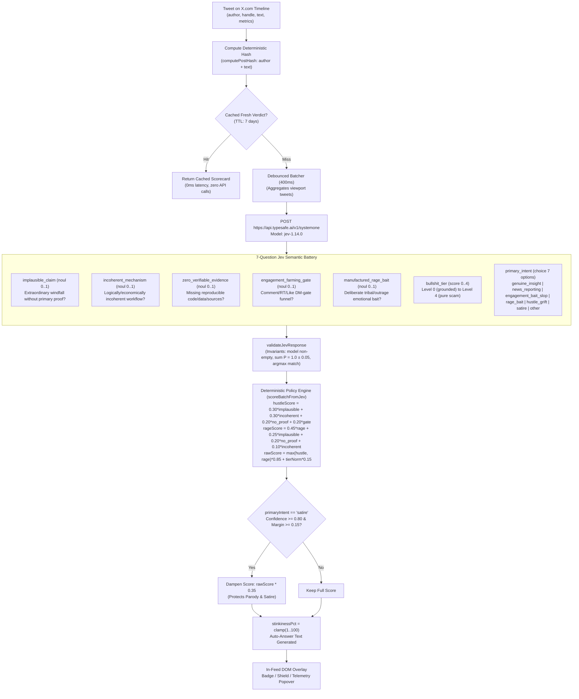

# 💩 bullshtt.ai — X.com Bullshit Scorer & Auto-Answer

> **Real-time X.com bullshit & rage-bait detector + 1-click objective auto-answer Chrome Extension powered by TypeSafe Jev (`jev-1.14.0`).**
> Every reply ends with: `rated XX% on stinkiness by bullshtt.ai`.

[](https://developer.chrome.com/docs/extensions/mv3/intro/)
[](https://typesafe.ai)
[-brightgreen.svg)]()
[](https://x.com)
[](LICENSE)

---

## 📌 Executive Overview

Social feeds on **X.com** are saturated with manufactured rage bait, engagement-farming DM gates (*"Comment CHEAT to get my secret prompt"*), unverified miracle claims (*"Made $420k in 7 days using Claude 3.7"*), and hustle grift. Readers waste attention arguing with bad-faith engagement bots or falling into predatory marketing funnels.

**bullshtt.ai (`Jevchrome`)** turns the tide with calibrated, typed semantic judgment powered by **TypeSafe Jev (`jev-1.14.0`)**:

1. **Passive In-Feed Telemetry**: As you scroll X.com, visible tweets are batched and evaluated against a 7-question Jev semantic battery.
2. **Visual Stinkiness Badge**: Each tweet receives an instant score indicator:
   - 🔴 **Stinky (75–100%)**: Blatant hustle slop, rage bait, or engagement farming.
   - 🟡 **Sus (40–74%)**: Sensationalized marketing, partial evidence, or promotional hype.
   - 🟢 **Clean (1–39%)**: Genuine insight, reproducible research, or grounded news reporting.
3. **Firewall Modes**:
   - **X-Ray Pill Badge**: Subtle badge next to the user handle with interactive telemetry popover on click.
   - **Collapse Shield Banner**: Collapses high-stinkiness posts behind a content shield until explicitly expanded.
4. **1-Click Auto-Answer in X Reply**: Inserts a concise, objective breakdown directly into X's reply composer (under 275 chars), strictly signed with:
   ```
   💩 BS Audit (@handle):
   • 99% Engagement-bait DM gate
   • 97% Implausible claim
   • 97% Zero verifiable proof
   • 82% Incoherent mechanism
   Verdict: Engagement-Bait Slop

   rated 89% on stinkiness by bullshtt.ai
   ```
5. **High-DPI Scorecard PNG Receipt**: Generates a 1200×630 dark-mode canvas receipt card copied straight to your clipboard (image + text) ready to paste (`Ctrl+V`) into your X reply as visual proof.

---

## 🧠 The 7-Question Jev Battery

Unlike brittle prompt-and-parse LLM wrappers, **bullshtt.ai** executes a calibrated, typed judgment battery in a single batched HTTP request to `https://api.typesafe.ai/v1/systemone` using **`jev-1.14.0`**:



### Battery Breakdown:

| Question Key | Question Type | Calibration Target |
| :--- | :--- | :--- |
| `implausible_claim` | `noul` (0..1) | Extraordinary financial, statistical, or factual claim without primary evidence |
| `incoherent_mechanism` | `noul` (0..1) | Buzzword salad, logically or economically impossible mechanisms |
| `zero_verifiable_evidence` | `noul` (0..1) | Fails to provide reproducible code, links, primary data, or testable citations |
| `engagement_farming_gate` | `noul` (0..1) | Artificial gatekeeping (*"Comment X to get DM"*, follow-to-unlock, fake giveaway) |
| `manufactured_rage_bait` | `noul` (0..1) | Tribal provocation, strawman attacks, outrage farming designed to provoke angry replies |
| `bullshit_tier` | `score` (0..4) | **Level 0**: Grounded/credible → **Level 4**: Pure fabricated grift / outrage scam |
| `primary_intent` | `choice` | 7 discrete options: `genuine_insight`, `news_reporting`, `engagement_bait_slop`, `rage_bait`, `hustle_grift`, `satire`, `other` |

### Satire Protection
Satire and humorous shitposting should never be conflated with malicious grift. If `primary_intent` is `satire` with confidence $\ge 0.80$ and an argmax margin $\ge 0.15$, the composite score is damped by **$65\%$** (`rawScore * 0.35`), marking the post safely as *Satire / Parody*.

---

## ⚡ 1-Click Auto-Answer in Action

When you spot a suspicious tweet, click the **`⚡ Auto-Answer in X Reply`** action button.

```
+------------------------------------------------------------------------+
| 💩 BS Audit (@techluisenzo):                                           |
| • 99% Engagement-bait DM gate                                          |
| • 97% Implausible claim                                                |
| • 97% Zero verifiable proof                                            |
| • 82% Incoherent mechanism                                             |
| Verdict: Engagement-Bait Slop                                          |
|                                                                        |
| rated 91% on stinkiness by bullshtt.ai                                 |
+------------------------------------------------------------------------+
```

### Key Auto-Answer Features:
- **Direct Editor Injection**: Automatically opens X's native reply composer and injects the text via Lexical/Draft.js reactive synthetic events.
- **Strict Signature Requirement**: Every message unconditionally ends with **`rated XX% on stinkiness by bullshtt.ai`**.
- **Character Limit Respected**: Dynamically sized to stay under **275 characters** so it posts immediately without requiring an X Premium subscription.
- **1200×630 Scorecard PNG**: Click **`🖼️ Copy Receipt Card PNG + Text`** to render a high-DPI dark-mode telemetry summary on HTML5 Canvas and write both `image/png` and `text/plain` to your clipboard for instant pasting.

---

## 🏗️ Repository Architecture

```
.
├── manifest.json              # Chrome Manifest V3 specification
├── engine/
│   └── bs_scorer.js           # Core Jev scoring battery, composite policy & validators
├── tests/
│   └── bs_scorer.test.mjs     # 8 Node.js unit + live Jev integration tests
├── server/
│   └── proxy.mjs              # Local Node.js / Cloudflare Worker caching proxy
├── scripts/
│   └── package-extension.mjs  # Production packager & validator (builds dist/ zip)
├── dist/
│   └── bullshtt-ai-extension.zip # Release-ready Chrome Web Store package
├── background.js              # Extension service worker (batch coordinator & proxy client)
├── content.js                 # X.com DOM observer, badge pills, firewall shield & reply injector
├── popup.html                 # Extension popup UI (manual tester, live feed & settings)
├── popup.js                   # Popup state controller & connection tester
├── popup.css                  # Dark-mode dashboard styling
├── icons/                     # Extension branding icons (16px, 48px, 128px)
├── package.json               # Scripts & dependencies
└── README.md
```

---

## 🚀 Quick-Start Guide

### Option A: Local Proxy Mode (Recommended)

Running the local proxy provides automatic file-based deduplication and persistent disk caching:

1. **Clone the repository**:
   ```bash
   git clone https://github.com/TrivelaAS/Jevchrome.git
   cd Jevchrome
   ```

2. **Set your TypeSafe API key**:
   Ensure `TYPESAFE_API_KEY` is exported in your environment or present in `/mnt/c/Claudeprojects/.env.local`:
   ```bash
   export TYPESAFE_API_KEY="ts_live_..."
   ```

3. **Start the proxy server**:
   ```bash
   npm start
   ```
   *The proxy starts on `http://127.0.0.1:8787` with health endpoint at `GET /api/health` and batched scoring at `POST /api/score`.*

4. **Load into Google Chrome**:
   1. Open Chrome and go to `chrome://extensions/`.
   2. Turn on **Developer mode** in the top right.
   3. Click **Load unpacked** and select the `/mnt/c/Claudeprojects/Jevchrome` directory.
   4. Open [X.com](https://x.com) and start scrolling!

---

### Option B: Direct Developer Key Mode (No Proxy Required)

If you prefer running standalone without the local background proxy:

1. Load the extension unpacked in `chrome://extensions/`.
2. Click the extension icon in Chrome's toolbar to open the **bullshtt.ai** popup.
3. Switch to the **⚙️ Settings & Connection** tab.
4. Enter your TypeSafe API Key (`ts_live_...`) under **TypeSafe API Key (Local Fallback)**.
5. Click **💾 Save Settings** and **⚡ Test Connection**. The extension will communicate directly with `https://api.typesafe.ai/v1/systemone` using model `jev-1.14.0`.

---

## 🧪 Verification & Test Suite

bullshtt.ai includes a comprehensive test suite running under Node.js native test runner (`node:test`):

```bash
npm test
```

### Test Suite Output:
```
> jevchrome@0.1.0 test
> node --test tests/bs_scorer.test.mjs

✔ computePostHash produces deterministic 16-hex hash with case-normalization
✔ buildJevBatchRequest builds valid Jev payload with explicit record identifiers
✔ validateJevResponse accepts conforming response and rejects invalid shapes
✔ scoreBatchFromJev computes accurate composite scores and checks satire damping
✔ formatAutoAnswer formats full and compact replies with required signature and < 280 chars
✔ isCacheEntryFresh verifies entry freshness, versions, and expiration
✔ Live integration test against TypeSafe Jev API (jev-1.14.0) with @techluisenzo post
✔ Proxy server endpoints: CORS, GET /api/health, and POST /api/score caching

ℹ tests 8
ℹ suites 0
ℹ pass 8
ℹ fail 0
```

---

## 📦 Building the Chrome Web Store Bundle

To validate all Manifest V3 schemas and package the production zip file for distribution:

```bash
npm run package
```

This builds `dist/bullshtt-ai-extension.zip` containing:
- `manifest.json` (V3 compliant)
- `background.js` (service worker)
- `content.js` (DOM injector)
- `engine/bs_scorer.js` (Jev engine)
- `popup.html`, `popup.css`, `popup.js` (popup UI)
- `icons/` (16px, 48px, 128px)

---

## ⚙️ Configuration Reference

Tuning options available in the extension's **⚙️ Settings** tab:

| Setting | Default | Description |
| :--- | :--- | :--- |
| **Auto-Scan Viewport** | `Enabled` | Automatically scores visible tweets as you scroll X.com |
| **Firewall Mode** | `X-Ray Badge` | Choose between subtle badges (`xray`) or collapsing stinky tweets behind a shield (`collapse`) |
| **Stinkiness Threshold** | `75%` | Score cutoff (50% to 95%) that triggers stinky alerts / shields |
| **Auto-Answer Style** | `Full` | `Full` (multi-bullet telemetry breakdown) or `Compact` (single-line summary) |
| **Proxy Endpoint** | `http://127.0.0.1:8787/api/score` | Local caching proxy or remote cloud endpoint |
| **TypeSafe API Key** | — | Direct API key fallback for autonomous operation without a proxy |

---

## 📄 License

MIT © [TrivelaAS](https://github.com/TrivelaAS)
