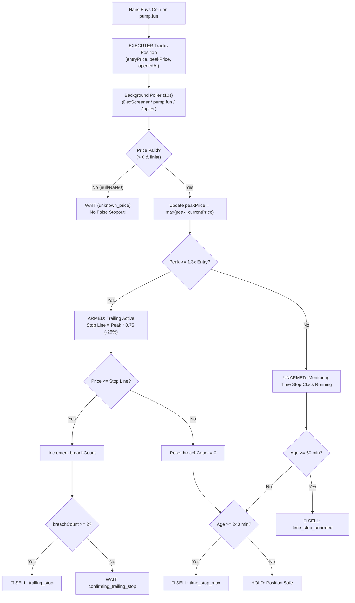

# 🛡️ EXECUTER — pump.fun Exit Guardian

> **Ultra-MVP Automated Trade Closer for pump.fun powered by the Combo 2 + 4 Exit Engine (Trailing Stop from Peak + Time Stops).**

[](https://developer.chrome.com/docs/extensions/mv3/intro/)
[]()
[](https://pump.fun)
[](LICENSE)

---

## 📌 Executive Overview

Hans executes buys on signals manually on **[pump.fun](https://pump.fun)** (`https://pump.fun/*`). Without strict automated exit enforcement, profitable runs round-trip back to entry and stagnant coins are forgotten until they bleed to zero.

**EXECUTER (`EXE-1`)** is a clean, self-contained **Manifest V3 Chrome Extension** that acts as an automated trade closer and high-water mark guardian:
1. **Manual Entry**: Hans executes buys on pump.fun.
2. **1-Click or Auto Tracking**: EXECUTER registers the mint, entry price/mcap, and timestamp.
3. **Continuous Background Surveillance**: Poller checks multi-source price feeds every 10 seconds.
4. **Deterministic Auto-Sell**: When exit conditions trigger, EXECUTER dispatches 100% sell execution to pump.fun so positions never go to zero.

---

## ⚡ Exit Policy: Combo 2 + 4

EXECUTER implements a pure, testable, and deterministic exit engine:



### 1. Rule 1 — Trailing Stop from Peak (Combo 2)
- **Arming Threshold (`trailArmX = 1.3x`)**: The trailing stop activates only once the token has proven traction (+30% gain).
- **Trailing Stop Line (`trailPct = 25%`)**: Auto-sells if price drops 25% below its highest high-water mark (`peakPrice`).
- **Debounce Confirmation (`trailConfirm = 2`)**: Requires 2 consecutive price checks below the line to protect against flash wicks and momentary slippage spikes.

### 2. Rule 2 — Unarmed Time Stop (Combo 4)
- **Stagnation Cutoff (`unarmedTimeStopMin = 60 min`)**: If a token fails to arm within 60 minutes, it automatically exits at 100% to free up capital before it bleeds to zero.

### 3. Rule 3 — Max Hold Time Stop (Combo 4)
- **Hard Ceiling (`maxHoldMin = 240 min / 4h`)**: Absolute backstop hold limit. No meme trade runs past 4 hours unmonitored.

### 4. Data Quality Guarantee: Unknown Is Never Zero
- If network drops, API rate limits, or price returns `null`, `undefined`, `NaN`, or `<= 0`, the engine returns `{ action: "WAIT", reason: "unknown_price" }`.
- **Zero false stop-outs on failed fetches**.

---

## 🏗️ Repository Architecture

```
.
├── manifest.json              # Chrome Manifest V3 specification
├── engine/
│   └── exit_rules.js          # Pure deterministic exit engine & metrics
├── tests/
│   └── exit_rules.test.mjs    # Node.js native unit test suite (100% pass)
├── background.js              # Service worker poller & auto-sell dispatcher
├── content.js                 # pump.fun DOM injector (pill & auto-seller)
├── popup.html                 # Sober terminal dark-theme UI
├── popup.js                   # Extension popup state controller
├── popup.css                  # Terminal aesthetics & color palette
├── icons/                     # Extension icons (16px, 48px, 128px)
├── package.json               # Scripts & metadata
└── README.md
```

---

## 🧪 Unit Test Suite

Run the unit tests natively with Node 20+:

```bash
npm test
```

### Output:
```
✔ Data Quality Guard: Unknown is never zero (0.6ms)
✔ Arming threshold: arms at 1.3x entry by default and stays armed (0.1ms)
✔ Trailing stop: triggers after confirmed consecutive checks below high-water mark (0.7ms)
✔ Trailing stop: resets breach count if price bounces back above stop line (0.1ms)
✔ Unarmed Time Stop: closes stagnant positions after 60 min if peak < 1.3x (0.1ms)
✔ Armed position does NOT trigger unarmed time stop at 60 minutes (0.1ms)
✔ Max Hold Time Stop: hard exit after 240 minutes regardless of armed status (0.1ms)
✔ calculatePositionMetrics returns correct multiples and stops (0.1ms)
✔ Custom config overrides are respected (0.1ms)
✔ Full pump.fun trade lifecycle simulation (0.2ms)

ℹ tests 10
ℹ pass 10
ℹ fail 0
```

---

## 🚀 Installation & Loading into Chrome

1. Clone the repository:
   ```bash
   git clone https://github.com/TrivelaAS/Jevchrome.git
   ```
2. Open Google Chrome and navigate to:
   ```
   chrome://extensions/
   ```
3. Enable **Developer mode** in the top right corner.
4. Click **Load unpacked**.
5. Select the `Jevchrome` repository folder.
6. Navigate to `https://pump.fun` to see the 1-click **"🛡️ Track in EXECUTER"** action pill on coin pages!

---

## ⚙️ Configuration Reference

All parameters can be tuned live in the extension's **Config ⚙** tab:

| Parameter | Default | Description |
| :--- | :--- | :--- |
| `trailArmX` | `1.30x` | Multiplier required to arm trailing stop (+30%) |
| `trailPct` | `25%` | Drawdown from high-water mark to trigger exit |
| `trailConfirm` | `2` | Consecutive poll checks required to confirm breach |
| `unarmedTimeStopMin` | `60 min` | Max wait time before cutting unarmed positions |
| `maxHoldMin` | `240 min` | Hard ceiling holding duration (4 hours) |
| `checkIntervalSec` | `10 sec` | Polling interval between price evaluations |

---

## 🔒 Security & Privacy

- No external telemetry tracking.
- All trade state is saved locally in `chrome.storage.local`.
- Zero private key exposure—executions trigger via user's active browser session and DOM interactions.
